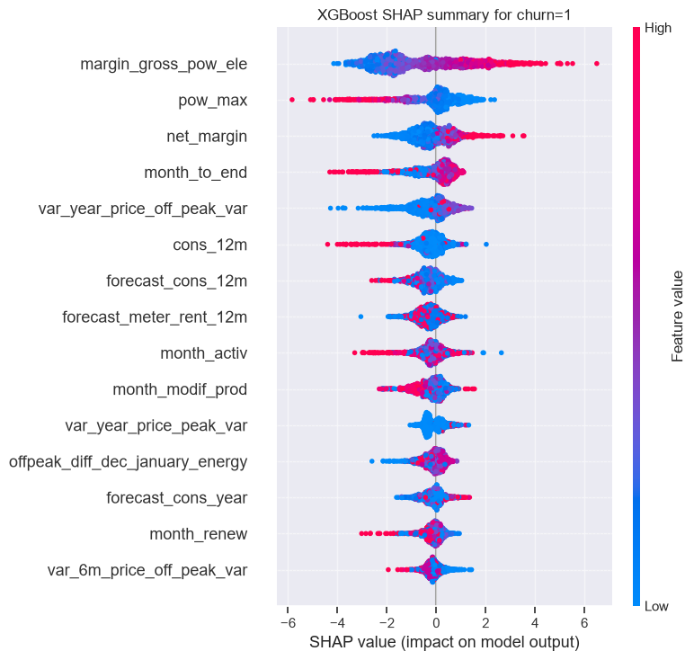

# Customer Churn Prediction for a Utility Company

Investigate potential reasons for customer churn and identify opportunities to improve retention.

The saved evaluation covers 1,461 test customers, including 142 churners. XGBoost achieves ROC-AUC
**0.7005** and F2 **0.4151**, making it the preferred model for this project based on the
current test results.

## Purpose

Explore how customer characteristics, contract terms and electricity prices relate to churn.
Use these findings to understand potential reasons for leaving, identify at-risk customers and
inform retention strategies.

## Dataset

The data were provided as part of the
[BCG Data Science & Analytics Virtual Experience Program on Forage](https://www.theforage.com/simulations/bcg/data-science-ccdz).
The source files are `client_data.csv` (customer attributes and churn labels) and
`price_data.csv` (customer electricity price history).

The supplied data contain 14,606 customer records and 193,002 price records. Each modelling row
represents one customer, with churn as the binary target. Around 9.7% of customers churned.

See [data instructions](data/README.md) for the training-program source and expected filenames.

## Method

1. Explore class balance, consumption, contract attributes and price history.
2. Aggregate customer price variation and changes; encode categories and derive date features.
3. Compare a Random Forest baseline, recall-tuned RF, balanced RF and XGBoost.
4. Select thresholds on validation data and compare fixed models on a shared test set.
5. Examine predictive associations using tree importance, permutation importance and SHAP.

## Evaluation design

All models share a stratified 80/10/10 split with seed 42: 11,684 training, 1,461 validation and
1,461 test customers. RF means Random Forest. ROC-AUC uses continuous probabilities; precision,
recall and F2 use the selected threshold. F2 places more weight on recall. AP is not included in the
final results table.

RF grid search optimises training-fold recall. XGBoost retains average-precision cross-validation
and validation aucpr early stopping. Thresholds are chosen on validation data; the test set is used
for reporting and post-hoc explanations. Upstream preprocessing still uses full-data category and
correlation rules, so this is not a fully isolated preprocessing evaluation.

F2 combines precision (P) and recall (R), with recall given greater weight:

$
F_2 = \frac{(1 + 2^2)PR}{2^2P + R} = \frac{5PR}{4P + R}
$

Here, precision is the proportion of flagged customers who actually churn; recall is the
proportion of all churners detected. F2 uses a recall weight of four relative to precision
in the weighted harmonic mean. It suits this project because finding more potential churners
is a priority, while excessive false positives still reduce the score.

## Results

Values come from the [saved evaluation CSV](artifacts/model_evaluation.csv), consistent with the
saved modelling output.

Bold values mark the highest score in each metric column. Threshold is a decision setting,
not a performance metric, so no threshold is marked as best.

| Model | Threshold | ROC-AUC | Accuracy | Precision | Recall | F2 |
|---|---:|---:|---:|---:|---:|---:|
| Random Forest baseline | 0.5000 | 0.6983 | **0.9110** | **0.8750** | 0.0986 | 0.1199 |
| Random Forest grid search | 0.5000 | 0.6888 | 0.8898 | 0.3827 | 0.2183 | 0.2388 |
| Balanced RF recall target | 0.1900 | 0.6884 | 0.6051 | 0.1498 | **0.6549** | 0.3911 |
| Balanced RF F2 | 0.2200 | 0.6884 | 0.6879 | 0.1770 | 0.6056 | 0.4080 |
| XGBoost F2 | 0.1592 | **0.7005** | 0.6934 | 0.1812 | 0.6127 | **0.4151** |

All five variants are evaluated on the same 1,461 customers, including 142 actual churners.
A flagged customer is someone whose predicted churn probability meets the chosen threshold.

- **Random Forest baseline:** Establish a reference using 300 trees, no class weighting and
  the default 0.5 threshold. It flags 16 customers, of whom 14 actually churn. This produces
  the highest precision (87.5%) and accuracy (91.1%), but recall is only 9.9%: it misses
  128 of 142 churners. Its conservative predictions make it unsuitable for broad churn detection.

- **Random Forest grid search:** Improve recall through five-fold training-set cross-validation
  over tree count, features per split and class weights, retaining the 0.5 threshold.
  It detects 31 churners among 81 flagged customers: recall rises to 21.8%, with precision
  of 38.3% and F2 of 0.2388. It improves coverage over the baseline but still misses most churners.

- **Balanced RF with a recall target:** Use class weighting and select the highest validation
  threshold meeting 65% recall. At threshold 0.19, it detects 93 churners among 621 flagged
  customers. It achieves the highest test recall (65.5%), but precision falls to 15.0%,
  with 528 false positives. This variant prioritises coverage and requires the largest
  contact list; its F2 is 0.3911.

- **Balanced RF with F2 tuning:** Use the same balanced model, but choose the threshold
  that maximises validation F2. At threshold 0.22, it detects 86 churners among 486 flagged
  customers. Compared with the recall-target variant, it reduces the contact list by 135
  while detecting seven fewer churners. Precision improves to 17.7% and F2 to 0.4080,
  with recall of 60.6%.

- **XGBoost with F2 tuning:** Fit boosted trees with cross-validation and early stopping,
  then maximise validation F2 to choose the classification threshold. At threshold 0.1592,
  it detects 87 churners among 480 flagged customers, giving precision of 18.1%, recall
  of 61.3% and F2 of 0.4151. It also achieves the highest ROC-AUC (0.7005).

**XGBoost is the best overall model in this comparison and the preferred model for this project.**
It combines the strongest overall ranking (ROC-AUC) with the highest recall-focused balance
of precision and recall (F2). Compared with balanced RF at its F2 threshold, it detects one
additional churner with six fewer flagged customers and seven fewer false positives.
The recall-target RF finds more churners, but XGBoost offers the better F2 trade-off.
The performance gap is small; repeated validation is the next step to check its consistency.

Both balanced RF variants have identical ROC-AUC because they use the same probabilities.
Changing their classification threshold changes precision and recall, not the probability ranking.

## Model interpretation

Subscription power margin, `margin_gross_pow_ele`, ranks first in permutation importance for both
models. Consumption, contract timing and subscribed power also contribute.



*Extracted from the saved modelling notebook. Points show customer-level SHAP contributions; colour
represents feature value. Positive values increase the explained output relative to its baseline.
XGBoost SHAP values may be on the raw-margin scale, so their magnitude is not a percentage-point
change in churn probability.*

Use these findings to design a controlled retention experiment. Compare incremental churn reduction,
retained margin and offer cost, rather than treating a high-risk score as proof of responsiveness.

## Setup and run

Install dependencies in a working Python environment:

```bash
python -m pip install -r requirements.txt
```

Place `client_data.csv` and `price_data.csv` under `data/`. Run the notebooks in order, with
`notebooks/` as the working directory:

1. [EDA](notebooks/eda.ipynb) exports `clean_data_after_eda.csv`.
2. [Feature engineering](notebooks/feature_engineering.ipynb) exports `my_data_for_prediction.csv`.
3. [Modelling](notebooks/modeling.ipynb) trains, evaluates, explains and saves results.

Models, thresholds, feature names, metrics and explanation tables are saved under `artifacts/`.
Apply the saved threshold to positive-class probabilities during inference. A complete fitted
preprocessing pipeline is not yet included.

## Project structure

```text
notebooks/       EDA, feature engineering and modelling
artifacts/       Saved estimators, metadata and result tables
data/            Source and generated CSVs (excluded from Git)
docs/images/     Figures referenced by this README
requirements.txt Python dependencies
```

## Limitations and next steps

- One random split and 142 test positives provide limited evidence about small performance
  differences. Add repeated validation and, where dated labels permit, a temporal holdout.
- Fit category grouping and correlation filtering on training data only. The current correlation
  loop includes numeric target data and only checks positive correlation.
- Date features discard direction through absolute differences. Price-difference names imply January
  and December, while the code uses first and last observed records. Refine these definitions before
  operational use.
- XGBoost reuses validation data for early stopping and threshold selection. Check robustness with
  fold-specific early stopping or out-of-fold threshold selection.
- Test-set explanations are descriptive. Feature selection based on them needs a fresh evaluation
  set.
- Evaluate equal contact budgets and controlled intervention outcomes before selecting a campaign
  policy.

## Skills

Python, pandas, exploratory analysis, customer-level feature engineering, stratified validation,
Random Forest, XGBoost, threshold selection, ROC-AUC evaluation, SHAP interpretation and business
communication.
